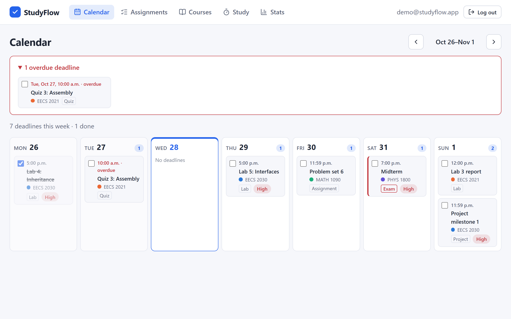
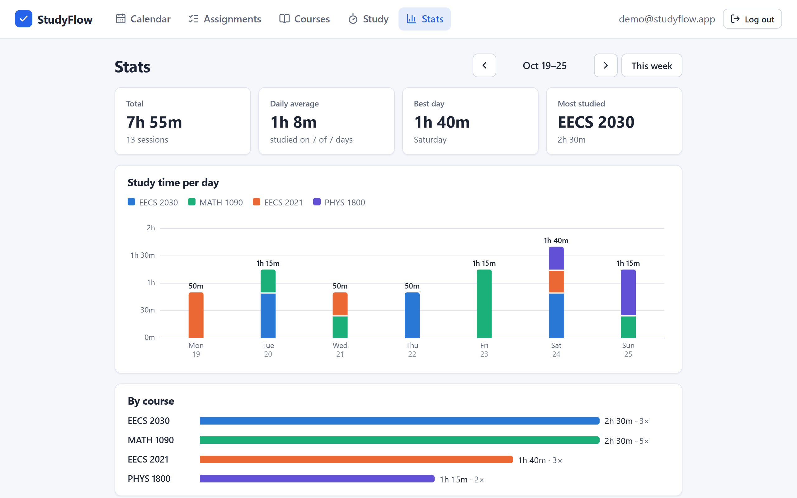
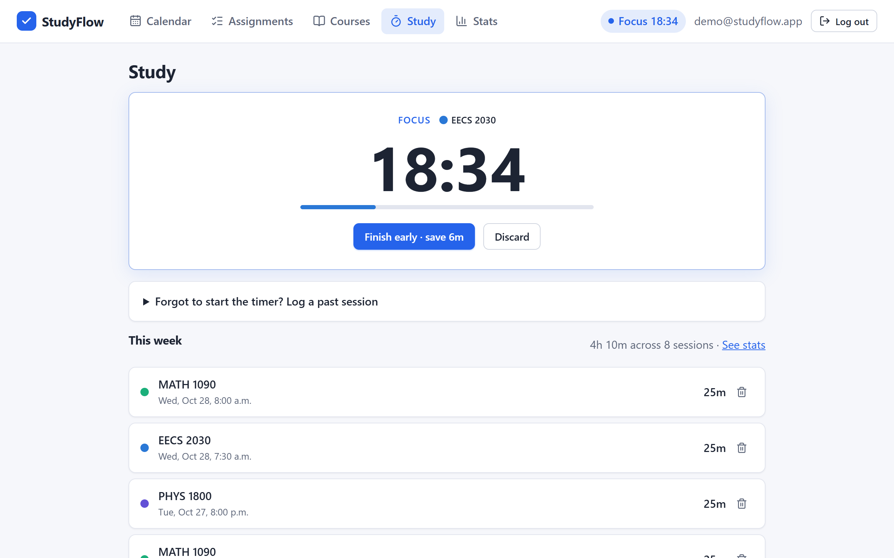
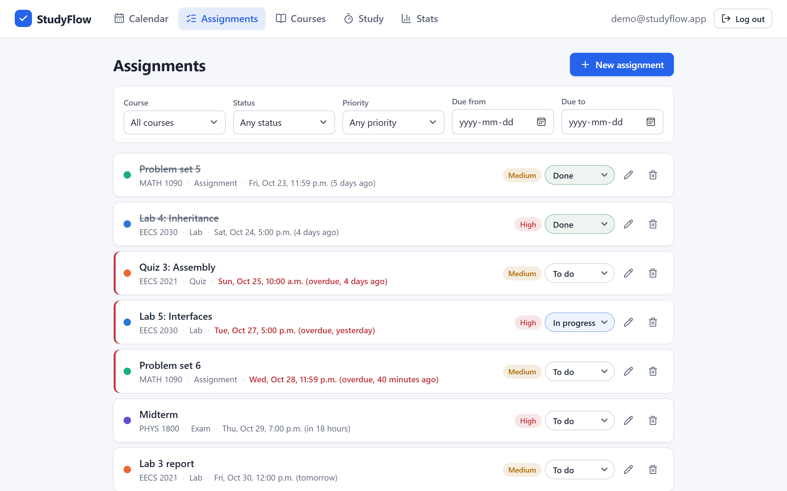
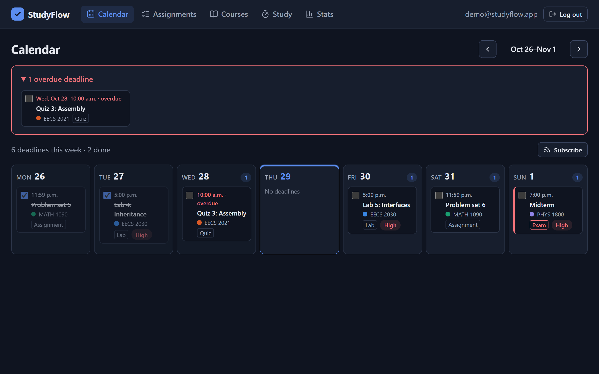
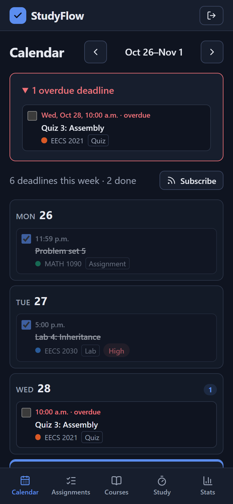
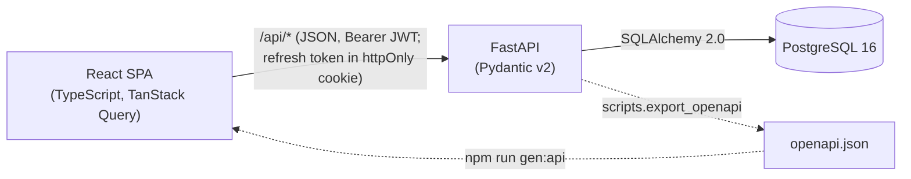

# StudyFlow

[](https://github.com/haydenho08/studyflow/actions/workflows/ci.yml)

A full-stack productivity app for students: track courses and deadlines, focus with a Pomodoro timer that logs study time per course, and see where your week went.

**[Live demo → studyflow-q3u0.onrender.com](https://studyflow-q3u0.onrender.com)** · the front page tours the features; click **Explore the demo** for a sample student account with this week's data (no sign-up), or register your own.
<sub>Free hosting: the first visit after a quiet spell can take ~30–60 s while the server wakes up.</sub>

**FastAPI · PostgreSQL · SQLAlchemy 2.0 · Alembic · React 19 · TypeScript · TanStack Query · Vite · pytest · Vitest · Playwright · Docker · GitHub Actions**



| Weekly study stats | Pomodoro timer |
|---|---|
|  |  |

| Assignments with filters | Dark mode | Phone |
|---|---|---|
|  |  |  |

## Features

- **Accounts:** register and log in with bcrypt-hashed passwords. Logins stay signed in through a rotating refresh token in an httpOnly cookie, with **Log out everywhere** for a lost device. **Settings** to change your password or email (confirmed by a link to the new address), reset a forgotten password by email, or delete the account. A one-click **demo account** rebuilds its sample data around the current week (in the visitor's time zone) whenever it's more than an hour old, so it never goes stale.
- **Courses and assignments:** assignments, quizzes, exams, labs and projects with due dates, priority and status; filters by course, status, priority and date range, all kept in the URL. **Repeating deadlines** ("Lab {n}" every Friday for 10 weeks) can be edited or deleted for only one week or for that week onwards.
- **Shared courses:** invite classmates with a link; everyone sees the course's deadlines and can add to them, while each person's status, marks and study time stay their own.
- **Grade tracker:** give deadlines a weight and enter marks to see each course's grade so far, the lowest and highest final grade still possible, and the average you need on the rest for every letter on York's scale.
- **Calendar week view:** deadlines placed on the right *local* day (including across daylight-saving changes), an overdue panel, and one-click "done".
- **Pomodoro timer:** 25/5 or 50/10 focus blocks that survive refreshes, sleep, background tabs and an expired login, and log each completed block to its course.
- **Calendar feed:** subscribe from Google, Apple or Outlook calendar with a secret link, and every deadline shows up there and stays up to date. The link can be replaced or turned off at any time.
- **Weekly stats:** totals, daily average, best day, and a stacked chart per day and course, bucketed in *your* time zone, with a table view.
- **Front page and polish:** a public landing page with scroll-in sections; pages, lists and charts animate in, and all motion switches off when the system asks for reduced motion.

## Engineering highlights

Each stage has a written walkthrough of the design decisions in [`docs/`](docs/).

- **Every query is scoped to what you can see.** Lookups go through one access module, and other users' data returns **404, not 403**, so the API never confirms it exists. With shared courses, members get an honest 403 for owner-only actions. Tests try every verb as another user. ([Stage 1](docs/stage-1.md), [Stage 10](docs/stage-10.md))
- **Time zones done properly.** UTC `timestamptz` in Postgres, offset-less datetimes rejected at the API, local-time conversion only at the edges, and **half-open date ranges** so consecutive weeks never double-count. Tests pin a DST-observing zone and cover the weeks when the clocks change. ([Stages 1–4](docs/))
- **One source of truth for the API contract.** Pydantic schemas → OpenAPI → generated TypeScript types for request bodies *and* query parameters. CI fails if either generated file is stale. ([Stage 2](docs/stage-2.md), [Stage 4](docs/stage-4.md))
- **Aggregation in SQL.** Weekly stats are a `GROUP BY` over the user's local day (`timezone(tz, started_at)::date`), not a Python loop over rows. Overlapping study sessions are rejected with the interval-overlap rule. ([Stage 3](docs/stage-3.md))
- **A timer that can't drift.** It stores *when it started* and derives the remaining time, so it's correct through background-tab throttling and sleep. Transitions are idempotent, so StrictMode, two tabs or a retry can't log a block twice. ([Stage 3](docs/stage-3.md))
- **Accessible charts.** Hand-built SVG with a colour-blind-validated palette (separate dark-mode steps), legend, keyboard-focusable tooltips, and a table view. Colour is never the only cue. ([Stage 3](docs/stage-3.md))
- **A calendar feed secured by its URL.** Calendar apps can't log in, so the feed URL carries a 256-bit random token that can be replaced or switched off at any time, and is separate from the login token. Unknown tokens get a 404. The iCalendar output (escaping, CRLF, folding long lines at 75 *bytes*) is hand-written and unit-tested. ([Stage 6](docs/stage-6.md))
- **Login that can't be lifted out of storage.** A 15-minute access token held only in memory, plus a refresh token in an `HttpOnly; Secure; SameSite=Strict` cookie that rotates on every use. Reusing an old one is treated as theft and ends the session. Access tokens name their session, so logging out takes effect immediately. CSRF is covered by SameSite plus an Origin check. ([Stage 7](docs/stage-7.md))
- **Repeating deadlines without special cases.** A weekly rule is expanded once into ordinary rows sharing a `series_id`, so filters, the calendar, the feed and stats need no changes. Dates are worked out on the student's wall clock, so a Friday 23:59 lab stays at 23:59 after the clocks change, and "this and following" edits shift by the same wall-clock amount. ([Stage 8](docs/stage-8.md))
- **Grades in exact decimals.** `NUMERIC` columns, `Decimal` maths and typed input sent as strings, so nothing passes through a float. Rounding is always cautious: grades round down, "needed" rounds up. The same rules are enforced by Pydantic and by Postgres `CHECK` constraints. ([Stage 9](docs/stage-9.md))
- **Shared data, personal progress.** Deadlines belong to the course, but status and marks live in a per-person `assignment_progress` table (no row means "to do"), and study sessions carry who studied. The migration copies existing data across instead of dropping it, and was checked row for row in both directions. ([Stage 10](docs/stage-10.md))
- **Account flows done carefully.** Emailed links are single-use, expire, are stored only as hashes, and carry their token in the URL fragment so it never reaches a server log. Password reset doesn't reveal who has an account, and email goes out after the response. Email providers are pluggable (`none` / `console` / `file` / `smtp`), and features that need email hide themselves when it's off. ([Stage 11](docs/stage-11.md))
- **Tested in a real browser.** Playwright runs 26 user journeys (sign-up, deadlines on the calendar, a full Pomodoro on a fake clock, the calendar feed, silent token refresh, logging out across tabs and devices, a repeating lab series, grades, sharing a course with a classmate who signs up from the invite, password reset through the emailed link), three of them also on a phone layout, against FastAPI serving the production build on a real Postgres. ([Stage 6](docs/stage-6.md))
- **Database integrity, not just app checks:** foreign keys with `ON DELETE CASCADE`, `CHECK` constraints for enums and session times, and reversible Alembic migrations tested both ways in CI.

## Architecture



In development, Vite proxies `/api` to FastAPI, so the browser sees a single origin (no CORS setup needed).

## Testing and CI

| | |
|---|---|
| **Backend** | 328 pytest tests against a real PostgreSQL (deliberately on a non-UTC session): auth, per-user isolation, validation, filters, cascades, overlap detection, time-zone bucketing, DST weeks, serving the built frontend, the calendar feed, refresh-token rotation and theft detection, CSRF, weekly recurrence across DST, exact grade maths and its rounding, shared courses (owner, member, outsider), password reset and account changes |
| **Frontend** | 87 Vitest unit tests for the logic most likely to hide bugs: date conversion across DST, URL filter parsing, PATCH diffing, timer maths and ownership, chart ticks, palette selection, repeat rules, grade wording, emailed-link tokens |
| **End-to-end** | 26 Playwright tests in a real browser (three also on a phone layout), each with its own fresh account: sign-up and login, the demo, course → deadline → calendar, filters, cascading deletes, a full Pomodoro on a fake clock, the calendar feed's lifecycle, staying logged in safely and logging out everywhere, a repeating series, weights and marks to a grade, sharing and leaving a course, forgot password, settings, deleting an account |
| **CI** ([workflow](.github/workflows/ci.yml)) | Ruff + ESLint, migrations up → check → down → up, all three test suites, typecheck + production build, generated-file freshness checks, production Docker image build |

## Running locally

Prerequisites: Docker Desktop, Python 3.12+, Node.js 24.

```powershell
# Database
Copy-Item .env.example .env
docker compose up -d db

# Backend (http://127.0.0.1:8000/docs)
cd backend
python -m venv .venv
.\.venv\Scripts\Activate.ps1
pip install -r requirements-dev.txt
alembic upgrade head
python -m scripts.seed_demo        # optional: demo@studyflow.app / studyflow-demo
uvicorn app.main:app --reload

# Frontend (http://localhost:5173), in a second terminal
cd frontend
npm install
npm run dev
```

Tests: `pytest` in `backend/`; `npm test`, `npm run lint` and `npm run build` in `frontend/`. `npm run test:e2e` builds the frontend, starts the API on port 8100 serving it, and runs the Playwright tests (locally in the installed Edge; set `PYTHON` if your virtualenv isn't `backend/.venv`). Screenshots are regenerated with `npm run screenshots` (Playwright, using the installed Edge).

## Project structure

```
backend/   FastAPI app (models, schemas, routers, ownership checks), Alembic migrations, pytest suite, scripts
frontend/  React + TypeScript SPA (pages, typed API client + query hooks, pure logic in lib/ with unit tests), e2e/ Playwright tests
docs/      Stage-by-stage design walkthroughs and screenshots
```

## Deployment

One multi-stage Docker image (FastAPI serving the API *and* the built React app) runs on Render, with PostgreSQL on Neon. A commit is deployed only after CI passes on it, and migrations run when the container starts. See [docs/deployment.md](docs/deployment.md).

## Roadmap

- Rate limiting and lockout on repeated failed logins
- Email reminders the day before a deadline

## License

[MIT](LICENSE) © Hayden Ho
