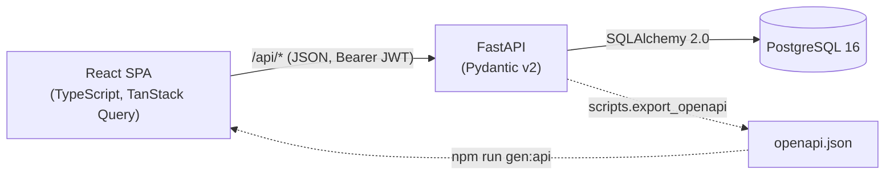

# StudyFlow

[](https://github.com/haydenho08/studyflow/actions/workflows/ci.yml)

A full-stack productivity app for students: track courses and deadlines, focus with a Pomodoro timer that logs study time per course, and see where your week went.

**FastAPI · PostgreSQL · SQLAlchemy 2.0 · Alembic · React 19 · TypeScript · TanStack Query · Vite · pytest · Vitest · Docker · GitHub Actions**


| Weekly study stats | Pomodoro timer |
|---|---|
|  |  |

| Assignments with filters | Dark mode | Phone |
|---|---|---|
|  |  |  |

## Features

- **Accounts:** register and log in with JWT bearer tokens; bcrypt password hashing.
- **Courses and assignments:** assignments, quizzes, exams, labs and projects with due dates, priority and status; filters by course, status, priority and date range, all kept in the URL.
- **Calendar week view:** deadlines placed on the right *local* day (including across daylight-saving changes), an overdue panel, and one-click "done".
- **Pomodoro timer:** 25/5 or 50/10 focus blocks that survive refreshes, sleep, background tabs and an expired login, and log each completed block to its course.
- **Weekly stats:** totals, daily average, best day, and a stacked chart per day and course, bucketed in *your* time zone, with a table view.

## Engineering highlights

Each stage has a written walkthrough of the design decisions in [`docs/`](docs/).

- **Every query is scoped to the logged-in user.** Lookups go through one ownership module, and other users' data returns **404, not 403**, so the API never confirms it exists. Tests try every verb as another user. ([Stage 1](docs/stage-1.md))
- **Time zones done properly.** UTC `timestamptz` in Postgres, offset-less datetimes rejected at the API, local-time conversion only at the edges, and **half-open date ranges** so consecutive weeks never double-count. Tests pin a DST-observing zone and cover the weeks when the clocks change. ([Stages 1–4](docs/))
- **One source of truth for the API contract.** Pydantic schemas → OpenAPI → generated TypeScript types for request bodies *and* query parameters. CI fails if either generated file is stale. ([Stage 2](docs/stage-2.md), [Stage 4](docs/stage-4.md))
- **Aggregation in SQL.** Weekly stats are a `GROUP BY` over the user's local day (`timezone(tz, started_at)::date`), not a Python loop over rows. Overlapping study sessions are rejected with the interval-overlap rule. ([Stage 3](docs/stage-3.md))
- **A timer that can't drift.** It stores *when it started* and derives the remaining time, so it's correct through background-tab throttling and sleep. Transitions are idempotent, so StrictMode, two tabs or a retry can't log a block twice. ([Stage 3](docs/stage-3.md))
- **Accessible charts.** Hand-built SVG with a colour-blind-validated palette (separate dark-mode steps), legend, keyboard-focusable tooltips, and a table view. Colour is never the only cue. ([Stage 3](docs/stage-3.md))
- **Database integrity, not just app checks:** foreign keys with `ON DELETE CASCADE`, `CHECK` constraints for enums and session times, and reversible Alembic migrations tested both ways in CI.

## Architecture



In development, Vite proxies `/api` to FastAPI, so the browser sees a single origin (no CORS setup needed).

## Testing and CI

| | |
|---|---|
| **Backend** | 108 pytest tests against a real PostgreSQL (deliberately on a non-UTC session): auth, per-user isolation, validation, filters, cascades, overlap detection, time-zone bucketing, DST weeks, serving the built frontend |
| **Frontend** | 60 Vitest unit tests for the logic most likely to hide bugs: date conversion across DST, URL filter parsing, PATCH diffing, timer maths and ownership, chart ticks, palette selection |
| **CI** ([workflow](.github/workflows/ci.yml)) | Ruff + ESLint, migrations up → check → down → up, both test suites, typecheck + production build, generated-file freshness checks, production Docker image build |

## Running locally

Prerequisites: Docker Desktop, Python 3.12+, Node.js 24.

```powershell
# Database
Copy-Item .env.example .env
docker compose up -d db

# Backend (http://127.0.0.1:8000/docs)
cd backend
python -m venv .venv
.\.venv\Scripts\Activate.ps1
pip install -r requirements-dev.txt
alembic upgrade head
python -m scripts.seed_demo        # optional: demo@studyflow.app / studyflow-demo
uvicorn app.main:app --reload

# Frontend (http://localhost:5173), in a second terminal
cd frontend
npm install
npm run dev
```

Tests: `pytest` in `backend/`; `npm test`, `npm run lint` and `npm run build` in `frontend/`. Screenshots are regenerated with `npm run screenshots` (Playwright, using the installed Edge).

## Project structure

```
backend/   FastAPI app (models, schemas, routers, ownership checks), Alembic migrations, pytest suite, scripts
frontend/  React + TypeScript SPA (pages, typed API client + query hooks, pure logic in lib/ with unit tests)
docs/      Stage-by-stage design walkthroughs and screenshots
```

## Roadmap

- Live demo (deployment is set up: see [docs/deployment.md](docs/deployment.md))
- Playwright end-to-end tests in CI
- `.ics` calendar feed (per-user secret URL) for Google/Apple Calendar
- Refresh tokens / httpOnly cookie auth

## License

[MIT](LICENSE) © Hayden Ho
